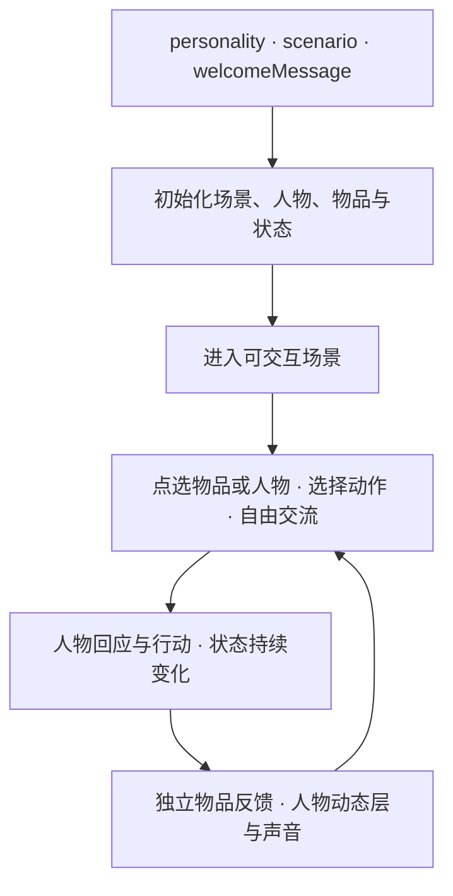

# Ludens 黑客松：以交互与参与感为核心的产品共识

更新：2026-09-22。读者：Sean 与两位运营伙伴。

2026-09-25 补充：当前可玩场景的范围、分工与试玩方式请先看 [伙伴说明](partner_demo_brief_20260925.md) 和 [运行说明](roleplay_live_20260925.md)。下文保留此前的产品讨论与阶段记录，技术状态以新版运行说明为准。

本文依据当前交互原型和 Sean 的最新反馈更新，可直接转给两位伙伴。Sean 主要负责技术支持；产品、内容、项目推进、用户验证与展示由两位伙伴主导。伙伴之间的具体归属、排期和验收门槛仍需共同确定。

## 我们要做什么

**Ludens 的核心是交互与参与感：我在场景里做了一件事，人物和环境给出能感受到的回应，并记住它。** 玩家可以观察、交流、操作物品、请求协作，也可以拒绝配合或自己尝试。关系通过共同经历发展。

名字来自 Homo Ludens，意为“正在玩的人”。长期愿景是可进入、可扮演的世界，体验期待接近精致游戏；这次黑客松先做好一个可玩的微场景。点击、文字和未来的其他输入方式，都服务于玩家主动介入世界。

Sean 明确：“我其实不是想做成影游，影游应该是个副产品，我更想做的是『交互』。” 当前交互版试玩后，Sean 反馈“非常好的效果，跟我想要的非常类似了”“非常贴近了”。这确认了继续推进的方向；更广泛的用户参与感仍需独立试玩验证。

始终保留这个检验标准：**“暂时拿掉视频，只保留场景、操作和角色反馈，这个体验还好玩吗？”** 影游或经历短片可以成为交互的副产品。

## 已确认的产品流程：从现有角色卡进入可交互场景

**输入沿用现有聊天模型的三个信息：`personality`、`scenario`、`welcomeMessage`。** 创作者填写角色卡，系统据此初始化场景、人物、物品与状态，然后进入持续交互。酒馆是这条流程的第一个验证场景。

Sean 确认的主线：

1. **输入：** `personality`、`scenario`、`welcomeMessage`。
2. **初始化：** 生成场景图、人物图、相关物品、可用操作和初始状态。
3. **持续互动：** 点选物品或人物、选择动作、自由交流，人物自主回应，状态持续变化。
4. **动态呈现：** 大场景通常保持稳定，视频表现人物的表情、说话和动作；接触物品时可共同呈现人物与该物品，物品状态和点击区域仍独立维护。声音原生生成或配 TTS。

**关键是：图里的东西就是能互动的东西，互动造成的变化会被记住。** 是否提供明确目标仍可讨论，这套流程也支持自由 Roleplay。

| 输入 | 在初始化中的作用 |
|---|---|
| `personality` | 人物设定、性格与行为倾向；其中已有的外观描述也作为人物图依据 |
| `scenario` | 场景背景、人物关系和当下处境，据此确定环境与相关物品 |
| `welcomeMessage` | 开场对白或叙述，确定进入时正在发生什么，以及初始动作和状态 |

三个字段共同决定同一个开场。未写明的视觉细节可在初始化时补齐并固定，已有设定与开场事实应保持一致。初始产物包括场景图、人物图、相关物品及其可用操作、初始状态；素材和状态要对应，例如图里的账册位置与初始物品位置一致。

**运行时的核心是“操作 → 人物回应与状态变化 → 可感知反馈 → 继续操作”。** 场景通常保持稳定，人物动态层表现表情、说话和动作，目标是随互动实时变化；物品与局部环境由各自状态驱动更新。人物可以自主回应与行动，玩家仍保有选择权。语音由模型原生输出，或搭配 TTS。

**9 月 23 日木箱小样后的更新：背景保持独立；人物接触物品时，允许两者作为共同视频层呈现，物品身份、状态与点击区域仍独立维护。** 无关物品不随视频重画，同一物品只显示一份。模型输出整幅 RGB 视频时，需提取所需区域后合成，不能假定原生透明输出。共同层修复箱沿缺口后，Sean 反馈“感觉好多了”；推动、松手和拆回独立物品仍待验证，见[木箱交互设计](crate_interaction_design_20260923.md)。初始化负责建立体验，运行时持续维护同一场景及其后果，不在每次交流时重新初始化。

这套流程支持有目标或自由 Roleplay；是否设置明确目标继续保留为讨论项，不增加必填目标字段。

### 已确认的模块划分

物品、背景、人物作为相对独立的模块，职责如下：

| 模块 | 职责 |
|---|---|
| 物品模块 | 用专门的代码统一管理物品生成、运行中的新增和变化，以及对应的物品素材、可用操作与状态；不只处理开场时的一批固定物品 |
| 背景模块 | 调用生图模型生成场景背景；大场景通常保持稳定，换场景时准备对应背景 |
| 人物模块 | 生成人物形象与动态人物层，承接表情、说话和动作；接触时与指定物品共同呈现，排除背景与无关物品，声音可原生输出或配 TTS |

三个模块共同对应同一份当前场景状态，物品新增或变化时，画面、可操作内容和后续记忆应一致。可交互物品应独立于背景管理，避免每次物品变化都要求重生成整个背景。这是已确认的职责划分，具体代码结构尚未实现。

### 生图与视频的分工

**2026-09-23 最新确认：** 背景、人物、物品的视觉素材均由生图模型提供，人物和物品也可以从同一张生成场景图中提取，保持画风一致。视频主要表现人物及其与物品的共同互动。物品外观使用图片／视频像素，不再采用 SVG 绘制；透明点击区域仍可用 SVG 或其他方式实现，不参与视觉呈现。物品身份、位置与变化由交互系统独立维护。

初始化顺序进一步确认：先生成完整背景底图，再生成与之匹配的人物和物品并分层呈现。可移动物品原先遮住的桌面等区域也应在底图中完整存在，物品移动后自然露出背景，不留下透明洞或黑块。当前实验通过补全背景验证了这一观感；背景优先的完整初始化流程尚待接入。

视频怎样贴回固定场景、何时拆层以及如何衔接下一次互动，已有小样但尚未定案，继续作为待验证项。等待资源后，Sean 指定 `24.144.74.11 / GPU 0`，已完成箱角补全与 LTX 固定路径两轮互动评测，页面 `/static/crate-continuation-20260923/index.html`；素材预生成，尚未接入在线聊天或正式酒馆状态。详细结果见[木箱交互设计与记录](crate_interaction_design_20260923.md)，本轮推理已自然结束，无后台自动排队。

**最新取舍：画质优先。** Sean 要求把已讨论的开源模型全面测试，允许更大的模型和更长的离线生成时间。人物糊、转身不稳、轮廓缺损的样片不因“已跑通”就接入展示。黑客松还有生成开场视频的悬赏，可复用角色参考、镜头描述、模型推理与音视频输出流程；开场视频与运行时人物分层分别验收。模型清单、统一素材与测试状态见 [画质评测记录](video_quality_20260922.md)。

Sean 建议由专门的生图模型确定视觉素材，视频模型以生图结果作为参考生成动态表现。保留 Seed7 人物外观，优先测试表情、转头与一句中文对白，并验证独立人物层。不同视频模型的参考接口需区分；Echo-WM Flash 接收首帧图，身份参考图与视频首帧不是同一个概念。视频首帧可以包含供模型参考的环境，合成时提取人物或人物与接触物品的共同区域，具体方式仍待验证。

9 月 22 日已在 Sean 指定的 180 / GPU 1 完成首轮生图→视频测试：4.04 秒短片带中文语音，但视频全流程约 138 秒（含加载），且出现乱码字幕；首帧多画了一个桶，视频也改变了物品。**该样片不满足独立人物层要求，不能直接接入交互场景。** 当前只证明离线链路可跑，未实现实时反馈。配置差异、原始样片和计时见 [人物测试报告](character_test_180_20260922.md)。

### 物品也由模型生成：实时性的讨论

Sean 补充：物品本身也可以由模型生成，当前物品的视觉与操作体验已获认可；需要验证能否从写死的物品扩展到互动中动态生成。

早期酒馆交互原型的物品外观是预先编写的 SVG，物品列表、位置及动作后果也有酒馆专用逻辑，所以操作快，不代表已经实现实时生成新物品。最新木箱评测已使用图片／视频像素，但尚未替换正式原型中的全部物品。可探索由模型生成物品定义（外观、位置、初始状态、可用操作与后果），统一交给物品模块呈现和执行。

此前考虑过模型生成 SVG 外观；最新确认已改为生图模型提供物品视觉素材。仍需测从提出新物品到首次可见、可操作的耗时，不能把前端绘制快等同于模型生成快。图片素材还需要处理前景分离、遮挡与场景风格匹配。

已有物品的位置、显隐、干湿等可表达的变化，优先更新状态与显示，不必每次重新生图；新增物品或显著改变外形时再生成对应素材。动态外观和新增物品的可执行行为必须一起考虑。这些是待验证方案，本轮未实现或启动推理。

**实现状态：** 当前酒馆验证了点选操作、状态延续和异步角色回应；自动从三个字段生成完整可交互场景，以及实时人物视频，均是接下来的实现目标，尚未完成。

## 当前体验：雨夜打烊

玩家与 Cassian 留在暴雨中的酒馆，窗框漏水威胁着旧账册。玩家可以接水、搬账册、擦水、请求帮助、观察或聊天，自行决定顺序。

酒馆背景常驻，桶、木箱、账册与毛巾是独立可操作的元素。接水不等于修好漏水，擦水会弄湿毛巾，移动木箱会带走仍放在其中的账册。基础操作立即更新，后果持续存在。Cassian 根据当前局面异步生成台词与行动；玩家等待期间仍可操作。

当前是“确定的物品规则 + 模型驱动角色”的混合原型。已支持的物品动作范围有限，角色的行动也受其约束。后续需要逐步扩大能理解和执行的意图，让玩家有更多尝试空间。尚未实现开放世界、任意行动或自由漫游。

美术延续已选 Seed7 的人物与风格。当前文字交流使用 Gemini API，物品操作不调用视频模型；服务使用 CPU 与远端文本 API。本地视频模型已停止，8 张 GPU 留给训练。经历时间线可以立即回看；视频短片保留异步接口，当前暂停。

实现、验证与启动说明见 [交互版记录](interactive_tavern_20260922.md)。

## 待讨论：需要目标，还是自由 Roleplay？

**这是开放的产品问题，尚未决定。** 酒馆漏水提供了一个可参与的局面，并不意味着产品必须围绕完成任务展开。先区分“场景中有事情发生”与“玩家必须完成目标”：角色可以有自己的需要，玩家仍可以选择参与、拒绝或谈论别的事。

| 方向 | 可能带来的体验 | 需要观察的问题 |
|---|---|---|
| 明确的小目标 | 容易开始，行动和阶段性结果清楚 | 会不会只顾完成任务，角色互动反而变得机械？ |
| 有情境、可自选目标 | 环境和人物提供参与理由，玩家自行决定是否介入 | 玩家能否自然找到想做的事，拒绝协作后是否仍然有趣？ |
| 自由 Roleplay | 玩家自行决定聊什么、做什么、发展怎样的关系 | 初次进入是否无从下手，是否愿意主动尝试并持续互动？ |

当前讨论建议是先尝试“有情境、可自选目标”，同时保留纯自由 Roleplay 的比较；这不是已确定的产品选择。两位伙伴可用同一个角色与场景，对比明确目标、只给情境、不提示目标时的体验，观察玩家如何开始、是否感到被推动、想不想继续。不要只以是否完成接水或保护账册判断体验好坏。

## 下一步：画随话动，也随行动变化

**“画随话动”是接下来的体验目标。** 对话有语气和表情，行动有可见的执行过程，执行后留下持续的场景变化。画面承接玩家和角色的实际互动。

例如，玩家把桶移到漏水处，桶立即到位；随后请 Cassian 帮忙，他根据当前局面决定如何回应。理想体验中，玩家能听见他的声音、看见他转头或伸手，也能看到他搬走账册后的空位。期间仍可处理毛巾、观察或继续表达意图。声音、表情和连续人物动作是待接入目标，不作为当前已实现能力展示。

图片编辑、TTS 与轻量动画可以先承担声音、表情和局部变化；**连续人物动作与场景演化，是接下来验证开源世界模型的重点。** 世界模型是重要候选，但并非每项声画反馈都必须等待它。需要在本场景中验证动作是否遵循意图、物品状态能否保持，以及等待是否破坏参与感。

生成的画面应尊重已经发生的事实：不能把移走的桶放回原位，也不能替玩家做尚未选择的事。新增声画能力不得阻塞基础操作；如果暂时只能表现结果，应如实区分结果变化与连续动作过程。

## 操作方式已确认：点选物品，再选动作

Sean 认可当前物品操作方式：**保留“点选物品 → 选择动作”，不增加拖拉拽。** 玩家表达的是操作意图，例如把桶移去接水、把账册放到安全处；当前体验不需要增加拖动、对准落点的负担。交互空间来自如何使用物品、先后顺序及与角色的协作。

## 如何把视频融入当前交互（待验证方案）

视频接入的目标是让实际互动拥有可见的动作与反应。经历短片仍可保留，但也要探索互动过程中人物自然地动起来。

以“把桶放去接水，再请 Cassian 帮忙”为例：

1. 玩家点选桶和动作，桶的位置立即更新，仍可继续操作。
2. Cassian 根据最新局面决定回应和行动。
3. 视频模型尝试呈现他的转头、表情或帮忙动作；支持原生语音时一同输出，否则搭配 TTS。
4. 画面中的动作结果须与实际场景一致，并自然回到可持续操作的场景。

**先考虑固定视角、短人物反应等较小变化，再验证人物接触物品的连续动作。** 不要求每次点选都生成整幅视频，也不把“等待视频播放结束”加入操作流程。

合成使用固定背景、独立人物层和独立物品层，根据实际前后关系处理遮挡。当前背景已包含 Cassian，因此还需制作去掉人物的背景底图，避免叠出两个人。先验证人物说话、转头等不接触物品的反应；涉及拿账册等动作时，账册仍由物品模块控制，需要与手部位置、遮挡和状态变化协调，不能把视频生成的另一份账册直接叠上去。人物抠像、机位与动作衔接尚待验证。

尤其要区分两种情况：玩家已完成的动作不能等视频才生效；角色即将执行的动作需要协调状态提交与画面时机，避免账册已经在架上、视频却仍显示角色正在取走它。生成期间如果玩家改变了相关物品，应舍弃或重生成不再成立的画面，不能让旧视频覆盖新事实。具体融合与同步方式尚未实现，需用现有模型的小样决定。

### 场景如何变化

当前建议固定酒馆空间与主要视角，让人物、物品和局部环境随互动变化。换地点时可以用新场景图作为起点，但不必现场等待生成：已知地点可提前制作，未知地点按需生成。返回旧地点时应恢复此前状态。场景图之外，还需要可点击对象与动作，不能把图片生成等同于可玩场景生成。

9 月 22 日已重新核实模型发布与已有资产，详见 [最新调研](world_models_update_20260922.md)。近期实质更新包括 LingBot 1.3B 和 SolarWM-H3；按复用顺序，先补测本地已有 Echo-WM Flash，再依据瓶颈选择人物模型或世界模型。这里只记录方向，尚未启动新推理。

## 优先复用已有开源模型

Sean 再次确认：**用咱们已有、已经测试过的开源模型。** 当前不以寻找闭源 API 为主线。现有 Gemini 角色调用继续使用，开源声画能力逐项接入，不要求同时替换所有组件。

| 已有资产 | 已知依据 | 当前方向中的用途 |
|---|---|---|
| FLUX.2-klein / FLUX.1-Kontext | 本地已有权重及生成、编辑代码；Kontext 用于此前酒馆开场图生成 | 复用以探索表情、姿态和局部画面变化；本交互版的速度与一致性需重测 |
| JoyAI-Echo（Joy） | 已跑通过带语音的视频，历史样例做过台词 ASR 核对 | 可直接承担声画生成；经历短片继续作为可选输出 |
| Echo-WM / DreamX-World | 已有离线 smoke，分别测试过动作条件和相机轨迹 | 按具体交互需要复用实验；既有结果不证明能实时完成酒馆物品操作 |
| Matrix-Game-2.0 | 本地已有权重与准备脚本；上述 smoke 报告未包含其运行验证 | 连续可控画面的后续候选，尚未验证本场景能力 |

**语音有两条路径：支持语音直出的模型优先使用其原生声画输出；不支持语音的模型可以配 TTS。** Joy 已有语音直出验证，无须把所有视频模型都默认配上 TTS。若原生语音必须等整段视频生成，独立 TTS 也可作为提前给出角色回应的候选；具体取舍看端到端等待与声画配合效果。本项目记录中尚未定位团队已测独立 TTS 的型号，后续先核对已有资产。

此前一次约 9.64 秒的 Joy 视频任务在单张 H100 上耗时约 78 秒，不含前置 LLM；Sean 反馈等待太慢、无法使用。因此保留现有即时交互基础，按实际瓶颈选择声画路径。这个结果针对已测链路，不代表所有模型或配置的速度。

实测依据：[模型 smoke 报告](world_model_smoke_report_20260905.md)、[此前视频闭环报告](ludens_pipeline_closedloop_report_20260906.md)。报告保留历史架构及样例结论；当前产品方向以本文为准。一次语音样例正确也不代表所有台词都能稳定生成。

推进顺序：两位伙伴先找出最影响参与感的一项缺口；Sean 复用已有资产验证对应声音、表情或动作；通过后再扩大范围。仅在明确的核心瓶颈无法合理解决时另评估闭源。本次仅更新文档与复核记录，不启动模型，不占用训练 GPU。

## 报名项目介绍（更新稿）

Ludens 是一个以交互和参与感为核心的 AI 角色扮演项目，面向喜欢角色互动、探索和沉浸式游戏的用户。我们希望解决用户行动难以改变环境、角色回应与画面脱节、互动后果难以延续的问题。玩家将在一个可操作的微场景里观察、交流、使用物品，自行选择如何与有自己意图的角色相处，让关系通过共同经历发展。项目沿用角色卡的 personality、scenario、welcomeMessage 三项输入，计划自动初始化场景图、人物图、相关物品和状态，以持续的场景状态和模型驱动角色构成交互基础，优先复用已有开源图片及视频／世界模型，利用模型原生语音或 TTS，逐步让声音、表情、动作和环境变化回应玩家。黑客松计划交付一个浏览器可玩的微场景 Demo、真实交互演示和试玩反馈报告，展示“观察—行动—回应—后果延续”的体验。

## 本轮范围与验证重点

- 继续打磨一个地点、一个主要角色、少量可操作物品，不扩成大型世界。
- 复用当前点选操作与中文交流，允许不同操作顺序、协作与拒绝；目标是否必需留待讨论。
- 验证玩家能否指出“这个变化是由我造成的”，是否想继续尝试，以及角色回应是否影响下一步行动。
- 检查物品与人物是否记住此前发生的事，异步声画不能覆盖更新的场景事实。
- 新增声音、表情和动作以增强参与感为依据；声画生成期间仍能操作。
- 自由漫游、群像、AR/VR、自训模型暂不作为本次交付项。

角色可以自主回应与行动，但不能预先替玩家选择。相机转动、人物移动和操作物品是不同能力，分别验证；好看的视频不能替代实际行动和持续后果的证据。

## 三人的建议分工

这里先按职责设 A/B，不按职位或资历分配。两位伙伴可根据专长交换，也可以共同讨论内容，但每项交付都应有一个明确负责人。

| 负责人 | 主责与可独立决定的事项 | 第一份交付 | 验收依据 |
|---|---|---|---|
| Sean：技术支持负责人 | 复用已有开源模型、验证声画与交互能力、说明实现成本、完成接入与技术实现、部署与排障 | 一份可演示的能力清单：稳定可用、偶尔可用、暂不支持；一个可重置的试玩入口或明确的运行安排 | 约定功能可以运行；技术限制与成本清楚；问题可定位 |
| 伙伴 A：产品、世界内容与玩法负责人 | 主导目标用户、体验承诺、功能范围与优先级；设计玩家身份、人物动机、场景对象、行动目标和世界规则 | 一页产品说明、三字段角色卡与情境卡，一张行动与后果表，三种不同意图的回应示例，五条必须记住的事实 | 用户知道为什么参与、能做什么；行动有可辨认的后果；产品范围清楚 |
| 伙伴 B：项目推进、用户体验与展示负责人 | 主导排期与任务跟进、试玩招募、问题管理、首次进入引导、展示材料与现场排练；跟进报名和外部协调 | 里程碑与任务表，一页试玩方案，一张问题表，一版三分钟展示提纲 | 交付有人负责且按期推进；用户问题得到复验；观众能看懂真实交互价值 |

两位伙伴共同决定产品体验与内容方向，A 收敛产品优先级，B 负责推进与组织验收。Sean 提供技术可行性、成本和替代方案，不作为所有非技术事项的默认拍板人。出现能力或时间冲突时，由两位伙伴依据技术评估决定缩范围、换体验方案或调整排期。

协作接口：两位伙伴给出“用户想做什么、应该看到什么、怎样算成功”，Sean 给出“能怎样实现、需要多久、有什么限制”。产品需求与验收由伙伴负责整理；技术实现由 Sean 负责。

运营伙伴的核心贡献，是决定“什么值得玩、怎样才算玩起来了”，并用实际用户反馈帮助取舍。

## 伙伴 A 可以直接填写的情境卡

| 字段 | 要填写的内容 |
|---|---|
| 适合谁 | 一个具体人群与体验偏好，例如喜欢试探人物、探索秘密的人；本轮只是待验证假设 |
| 玩家身份 | 我是谁，与眼前人物是什么关系 |
| 主要角色 | 想要什么、怕什么、愿意说什么、暂时隐瞒什么 |
| 空间与氛围 | 一个地点；人物站位、关键物品、色调和声音参考 |
| 可互动内容 | 少量人物、物品或区域；每项有什么用途，玩家如何发现它 |
| 开场钩子 | 第一眼看到什么，第一句听到什么，为什么想回应 |
| 可选的参与动机 | 玩家可能想弄清或改变什么；也记录不提供目标时如何开始互动 |
| 三种意图 | 例如接近／试探／拒绝；每种都写人物回应与可观察的变化 |
| 必须记住的事实 | 五条以内；区分不可改的设定和行动后可更新的事实 |
| 受限行为的回应 | 遇到当前难以呈现的动作，怎样合理回应并保留用户意图 |
| 一个收束点 | 可自然形成的小结果；目标是否必需待讨论，不强迫固定轮数或同一结局 |

回应示例用于表达质量要求，不是必须照播的预制分支。人物原则和世界事实应能支持未预先写出的输入。

行动与后果表另列：玩家意图、行动对象、需要看到的执行过程、完成后的事实变化、下一轮怎样验证、当前技术是否支持。例如“把信递给对方”要检查接收或拒绝的动作与信件归属；该例只是验收样例，不表示已稳定实现。

## 伙伴 B 可以直接使用的试玩记录

先找约五位未参与制作的人做小规模探索；人数用于发现问题，不用来宣称产品已验证成功。只记录必要的体验信息，录屏或保存原话前取得参与者同意。

开场只给进入体验所需的说明，先观察用户能否自己开始。结束后再询问具体时刻，避免一上来用“是不是很沉浸”引导答案。

| 记录项 | 示例或口径 |
|---|---|
| 用户想做什么 | “我想试探他有没有撒谎” |
| 实际输入 | 原句，或用户点击的建议 |
| 用户期待的回应 | 事后询问，区分真实期待与团队猜测 |
| 实际发生什么 | 画面、对白、后续记忆分别记录 |
| 等待 | 操作反馈与角色回应分别计时；接入声画后记录各自延迟，以及等待期间能否继续操作 |
| 用户表现 | 是否重复点击、追问、放弃、继续输入 |
| 问题严重程度 | 阻断体验／破坏理解与信任／一般美感问题 |
| 归属与复验 | 负责人、拟修改项、下一次如何确认解决 |

结束后重点问：你觉得自己是谁？哪一刻最像是你改变了局面？有没有一次回应与你做的事对不上？你还想继续做什么？

## 第一轮怎么合作

尚未确定截止日期，先按交付顺序排，不绑定具体日历。

1. **共同对齐，建议 45 分钟。** 先各自试玩当前酒馆交互版，再确认目标用户、玩家身份、核心体验、展示要求，以及 A/B 归属。会议产出是一张情境卡骨架与范围决定。
2. **并行准备。** A 完成情境卡和回应样例；B 完成试玩方案和展示提纲；Sean 核实当前原型能力、运行方式和生成耗时，并列出内容约束。
3. **三人桌面演练。** 不调用视频模型，先用三条不同用户输入推演人物应该怎么回应、什么事实会改变。消除情节动机与状态上的矛盾。
4. **验证一次共同经历。** 从同一开场尝试不同操作顺序、请求帮助或拒绝配合，核对行动、人物回应和持续后果。比较有目标与自由互动时的参与意愿，再选择声画增强项。
5. **小规模试玩。** B 主持，A 观察人物与情境，Sean 按需提供运行与排障支持。A/B 根据问题表与技术成本评估决定下一轮最多三个优先修复项。
6. **冻结并排练展示。** 保留可重置的现场交互版本，另备一次真实运行的录屏；使用录屏时明确说明，现场生成和预先制作的素材分别标注。

协作约定：共享同一份情境卡和问题表；内容变更先检查是否增加人物、地点或难呈现的动作；技术限制用产品语言说明，并给可替代方案。每轮验收后再扩大范围。

## 建议的交付门槛

这些是首次对齐时要讨论的目标，不是已经达到的结论。

| 维度 | 建议门槛 |
|---|---|
| 可理解 | 试玩者能说清自己是谁、能尝试什么；分别记录有目标和自由模式中的困惑 |
| 可参与 | 玩家能自主尝试不同办法；角色等待期间仍可操作；系统不替玩家选择 |
| 有后果 | 至少两种不同意图得到明确不同的回应；用户能指出自己造成的一项变化 |
| 能行动 | 至少一个非对话动作有可辨认的执行过程和持续后果；用户知道可以尝试行动，而不只是聊天 |
| 有记忆 | 一个关键选择或物品变化在后续两轮继续有效 |
| 连续性 | 一次共同经历中不出现身份漂移、关键物品复位、动作与叙事矛盾 |
| 声画可理解 | 当前角色文字可读；接入声画后语气、表情和动作应与实际事件相符 |
| 等待可接受 | 先实测并记录放弃情况，再共同定阈值；演示如实体现等待成本 |
| 可展示 | Sean 以外的伙伴能按说明完成开始、连续操作与重置；有清晰的失败恢复办法 |

少量试玩只用于决定下一步，尤其要区分“不喜欢这个题材”和“交互机制没有成立”。

## 三分钟展示提纲草案

- 约 20 秒：一句话介绍用户和体验承诺。
- 约 30 秒：展示开场，让观众知道自己是谁、为什么想回应。
- 约 90 秒：展示一次物品操作、一次角色回应及持续后果，让观众看见玩家在角色回应期间仍可操作；已接入的声画能力随互动展示。
- 约 40 秒：说明当前做到了什么、还没解决什么、下一步最值得验证什么。

演示应把“输入—回应—后果持续”讲清楚，并说明开场图等哪些素材预先准备。世界模型研究愿景可以提，但不能代替当前产品体验的证据。

## 首次对齐需要补齐的信息

- 黑客松截止时间、评审标准、现场是否允许联网与等待、展示时长。
- 两位伙伴各自的专长、兴趣、投入时间，以及谁主责 A/B。
- 第一批试玩者从哪里来，是否与当前中文微场景的目标体验人群匹配。
- 现有单人情境是否足以形成玩家动机；若不够，最小内容调整是什么。

项目历史参考：[闭环报告](ludens_pipeline_closedloop_report_20260906.md)。报告描述的是当时的验证结果，不代表现在已经完成全部体验要求。

## 附录：此前世界模型 API 资料（当前不推进）

以下仅为备选资料，当前按“开源模型优先，遇到明确瓶颈再评估闭源”推进。此前仅核实官方公开资料，没有注册付费、实际调用或测量效果。

| 服务 | 官方公开能力 | 对本项目的意义与待验证点 |
|---|---|---|
| Odyssey-2 Pro | 实时交互视频流 API；官方 SDK 支持用图片开始视频流、通过 `interact(prompt)` 在流中追加文本指令 | 若现有方案遇到明确瓶颈，可验证连续画面中的动作控制；文本指令接口不等于游戏式键鼠控制，动作准确性、人物一致性、对白能力与成本仍需实测 |
| World Labs / Marble World API | 异步生成可探索的 3D 世界，返回场景资产与碰撞网格等 | 为可漫游空间提供另一条路线；根据接口产物判断，NPC 行为、剧情与物品交互仍需要应用侧设计实现 |
| Google Genie / Project Genie | 官方提供可交互的研究原型体验入口 | 本次未找到公开开发者 API 文档，暂不把它算作可直接集成的后端 |

Odyssey 官方 FAQ 当前写明单条交互流最长 150 秒；同一连接可以顺序开启新流，但这不证明跨流世界记忆自动连续。是否适合长会话需另测。若后续需要比较 API 候选，应复用现有方案的体验任务；不因 API 存在就直接承诺自由漫游或完整 RPG 能力。

官方来源：[Odyssey API](https://documentation.api.odyssey.ml/)、[官方 Python SDK](https://github.com/odysseyml/odyssey-python)、[Odyssey FAQ](https://documentation.api.odyssey.ml/faq)、[World API 公告](https://www.worldlabs.ai/blog/announcing-the-world-api)、[World API 文档](https://docs.worldlabs.ai/api)、[Project Genie](https://labs.google/projectgenie)。
