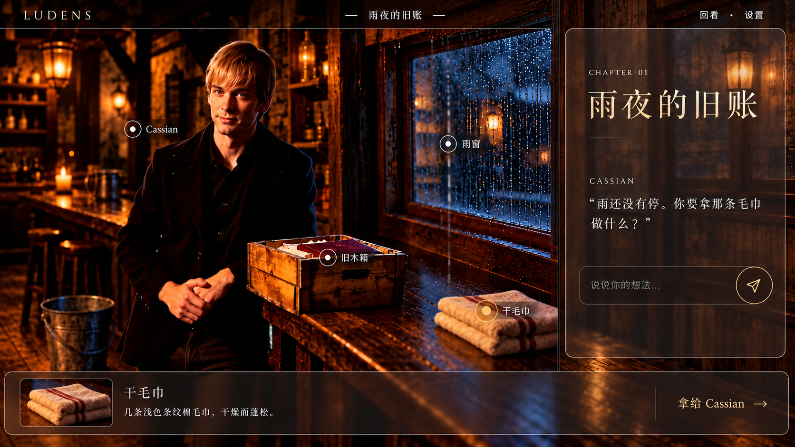
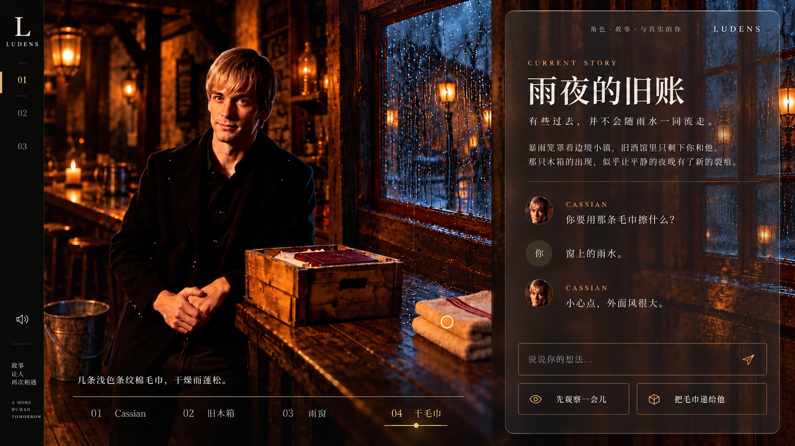
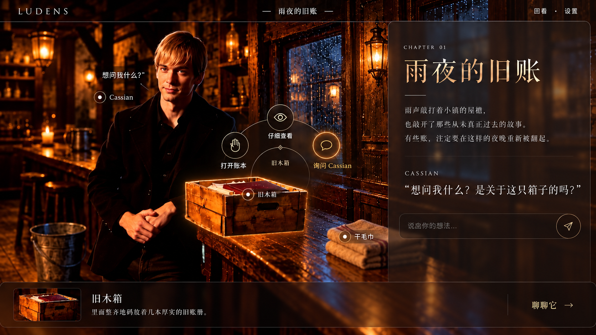
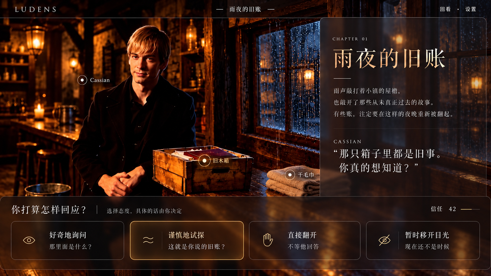
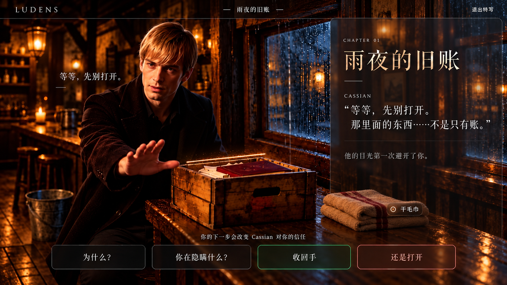
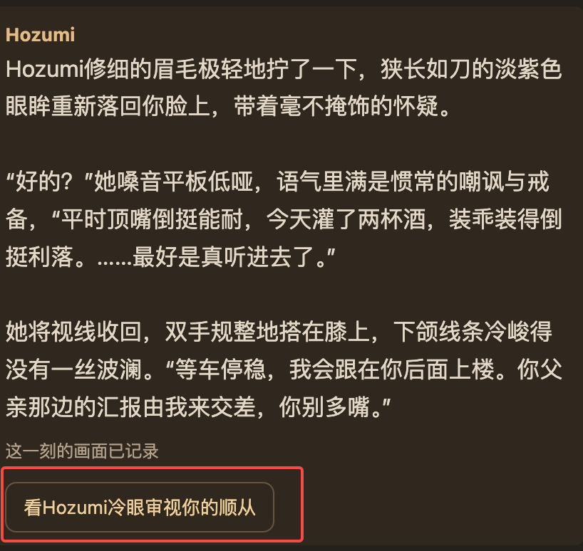
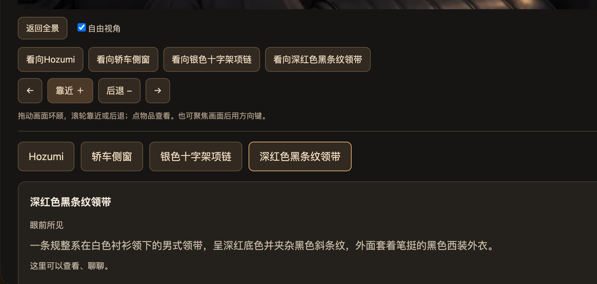
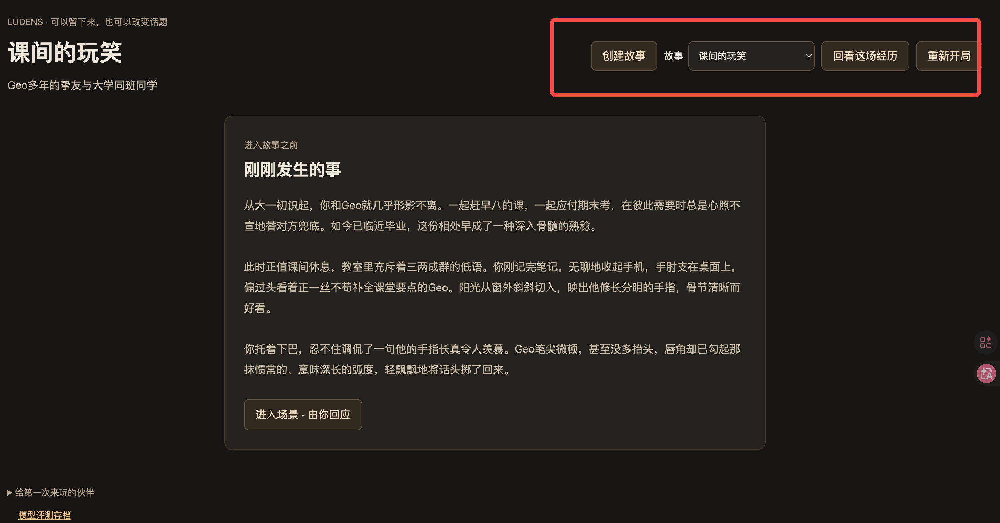
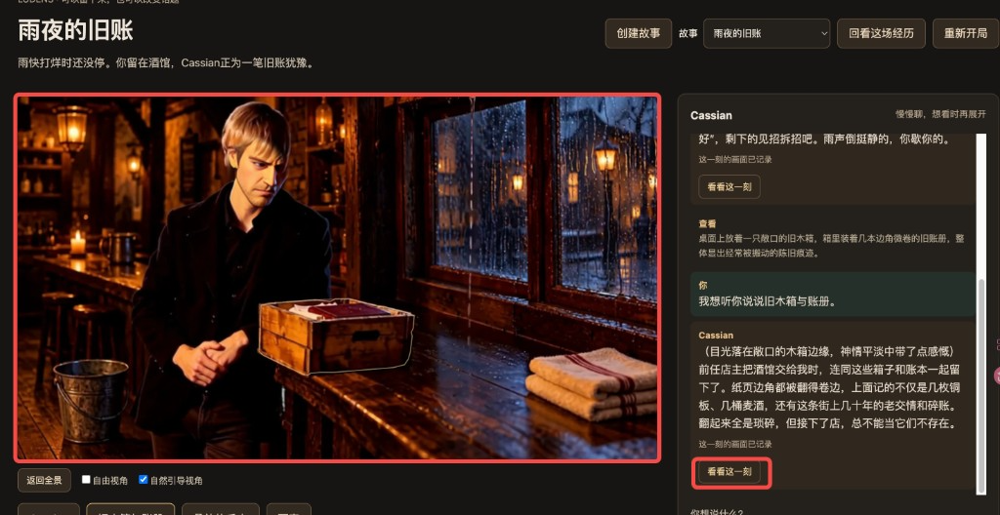

# 体验建议

### 整体设计参考

> 仅为风格参考，不代表最终效果

1. 主页面参考图

<grid>
<column width-ratio="0.500000">

</column>
<column width-ratio="0.500000">

</column>
</grid>

以图片为主，增强体验沉浸感，在不遮挡主要互动选项的同时，用相近色块或图片延伸填充右半部分，使右边对话和介绍栏以及其他按钮半透明。

1. 互动内容参考图

<grid>
<column width-ratio="0.333333">

A 点击木箱后，选项直接围绕物件展开
仔细查看、打开账本、询问 Cassian。操作距离短，游戏感更明显。
</column>
<column width-ratio="0.333333">

B 选择人物态度
用户不选择写死的台词，而是选择“好奇、谨慎、直接、回避”，系统再根据态度生成回应。最符合角色扮演产品。
</column>
<column width-ratio="0.333333">

C 人物主动打断
点击关键物件后，Cassian 主动伸手阻止，页面进入剧情特写，并提供可能影响信任的选择。戏剧性最强。
</column>
</grid>

- 平时探索和对话部分可以采用ab，只有关键剧情节点才切换到c。这样既容易操作，也不会让每次点击都显得过于夸张。

### 视频生成按钮

按钮读着拗口，且并不能明确让用户知道这个功能是视频功能，建议统一改成明确的动作：

- 生成前：让这一幕动起来 / 生成这一刻的视频
- 生成中：正在生成视频…
- 生成后：查看视频 / 重温这一刻

### 左边双排按钮

现在两排按钮名称接近，却执行不同操作，用户很难理解区别。

建议合并为一次操作：

- 点击“轿车侧窗”
- 画面自动聚焦侧窗
- 同时选中对应标签并展示下方详情、相关聊天记录

只保留一排地点/物品按钮即可。若确实需要单独控制镜头，可在对象旁放一个明确的“聚焦”图标（放大镜啥的）。

其实就是取消自由视角，保留自然引导视角，这个自由视角没看出太大区别，反而操作更复杂了。

### 创建故事

进入页面默认让用户“继续一个故事”，但真正的入口“创建故事”被藏在右上角，而且“创建”也不准确——用户实际是在选择现成剧本。

建议流程：

1. 首次进入先显示选择故事
2. 用故事卡片展示简介、角色与背景
3. 用户点击开始这个故事
4. 再进入“刚刚发生的事”和具体场景

右上角的“创建故事 + 故事下拉框”可以合并成一个明显的 选择故事 入口，进入游戏后，右上角设计保留。“重新开局”仅用于重置当前故事，并增加确认提示。这样“选剧本”和“进入游玩”的逻辑会清楚很多。

### 视频播放

目前视频播放是通过点击按钮，弹出小窗口观看，但左侧本身就是页面的视觉主舞台，弹出小窗口反而造成：

- 大图仍占据视线，视频却很小
- 用户注意力被分成两处
- 关闭弹窗、继续互动的操作更繁琐

建议点击“查看这一刻”后，直接将左侧图片切换为视频播放，并保留图片作为视频封面；播放结束后显示“重新播放”和“返回场景”。